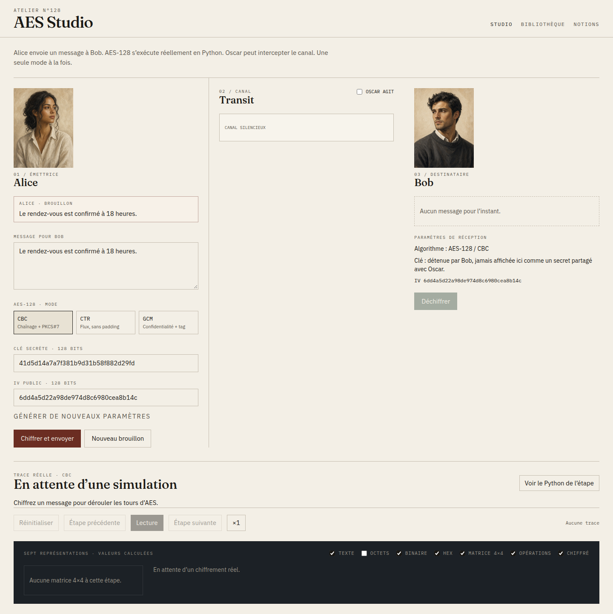
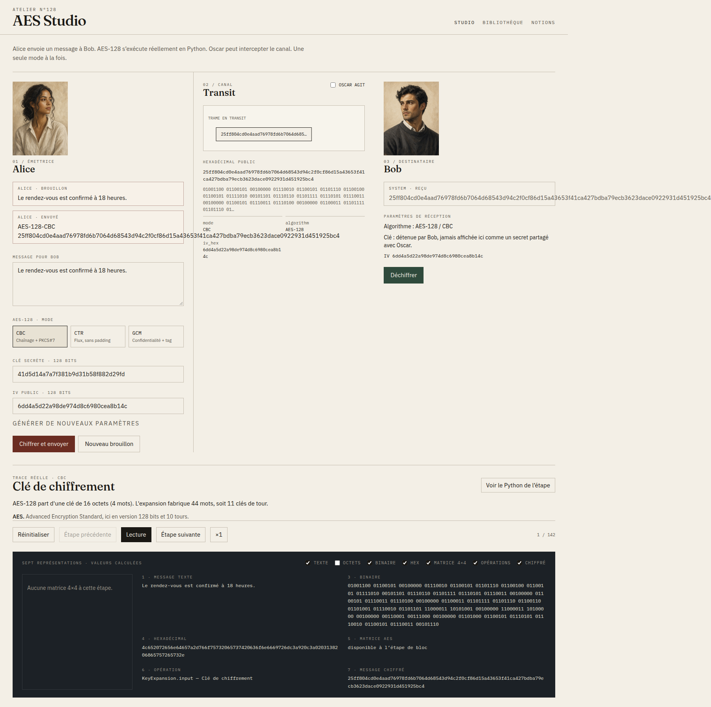
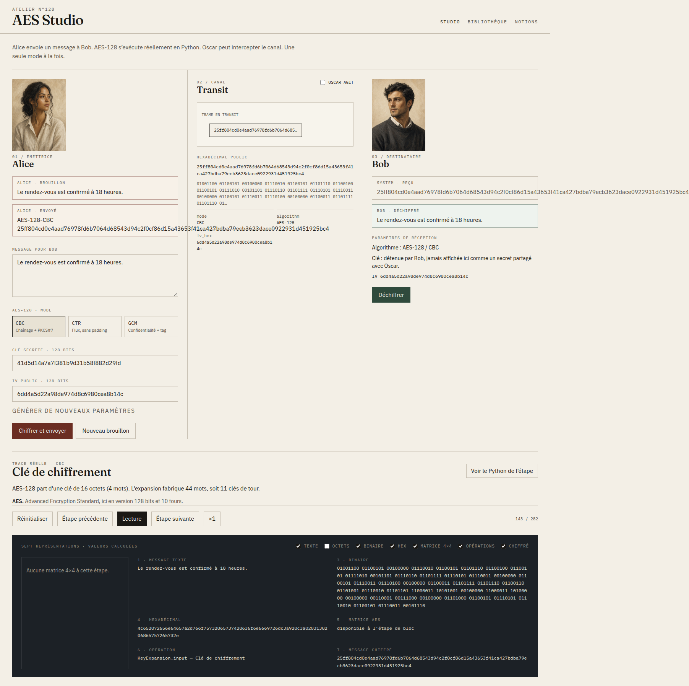
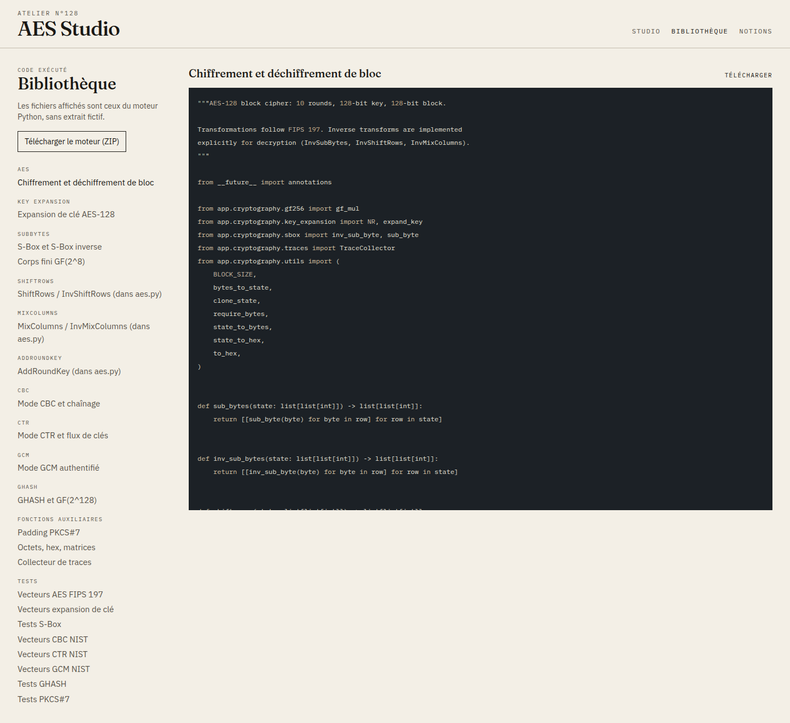
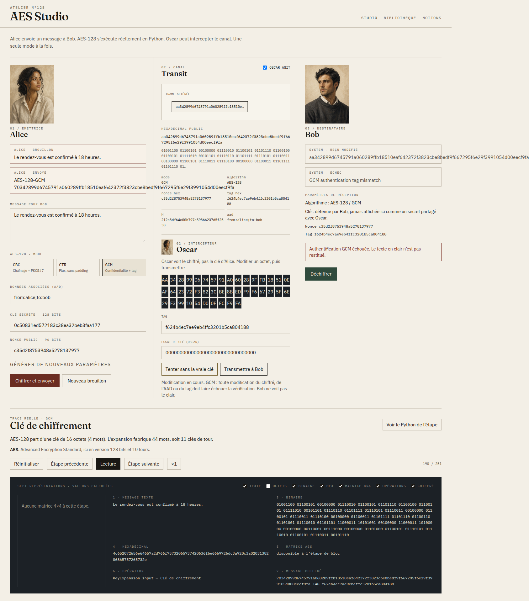
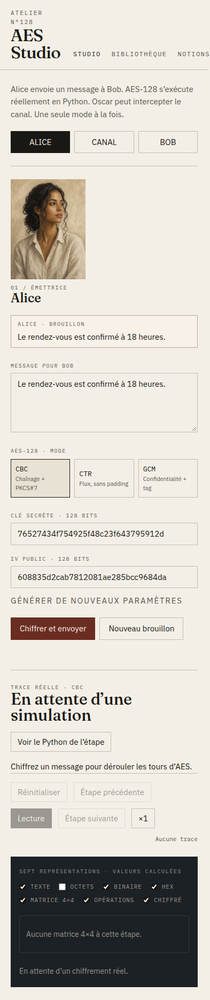

# Rapport technique — AES Studio

**Date :** 31 octobre 2026 (Africa/Douala, UTC+1)  
**Auteur :** développement réalisé dans cet atelier  
**Statut :** application pédagogique fonctionnelle, tests NIST exécutés

Ce rapport décrit uniquement le travail réellement effectué. Les captures sont des extraits de l’interface en cours d’exécution. Les résultats de tests ont été obtenus par `pytest` et par un navigateur headless.

---

## 1. Présentation générale

### Objectif

AES Studio est une plateforme web pour comprendre, visualiser et expérimenter **AES-128** et trois modes : **CBC**, **CTR**, **GCM**. Le scénario met en scène Alice (émettrice), Bob (destinataire) et Oscar (intercepteur).

### Fonctionnalités livrées

| Fonction | État |
| --- | --- |
| AES-128 écrit à la main (10 tours, S-Box générée, expansion de clé) | Terminé |
| CBC + PKCS#7, CTR sans padding, GCM + GHASH + tag | Terminé |
| Traces pédagogiques pas-à-pas (états 4×4, hex, explications) | Terminé |
| API FastAPI et studio React | Terminé |
| Mode attaquant Oscar (modification d’octets, essai sans la clé) | Terminé |
| Bibliothèque du code Python réel + ZIP | Terminé |
| Glossaire contextuel et page Notions | Terminé |
| Docker Compose | Terminé |
| Tests unitaires / API / vecteurs NIST | Terminé (50/50) |
| Tests e2e automatisés dans le dépôt | Non livrés (vérification manuelle + Chrome headless) |
| Nonce GCM autre que 96 bits | Non implémenté (démonstration standard uniquement) |

### Choix technologiques

- **Moteur :** Python 3.12, modules séparés, aucune bibliothèque AES.
- **API :** FastAPI + Pydantic + Uvicorn.
- **Interface :** Vite, React 19, TypeScript, Tailwind CSS 4, Framer Motion, React Router.
- **Aléatoire :** `secrets.token_bytes`.
- **Déploiement :** Docker Compose (Nginx + Uvicorn).

L’interface n’utilise pas de kit de composants générique. La direction visuelle est éditoriale : papier crème, titres Fraunces, texte IBM Plex Sans, hexadécimal IBM Plex Mono, zones techniques sombres, coins droits, pas de dégradé décoratif.

---

## 2. Architecture

### Frontend / backend

```
Navigateur (43123)
    │  REST JSON /api/*
    ▼
FastAPI (48180)
    ▼
app/cryptography  (AES, CBC, CTR, GCM, GHASH)
```

En développement, Vite proxy `/api` vers FastAPI. En Docker, Nginx fait le même relais. Aucun appel à un service cryptographique externe.

Les animations relisent une **trace pré-calculée**. Reculer d’une étape ne relance pas AES.

### Modules

**Backend**

- `app/cryptography/` — moteur
- `app/services/crypto_service.py` — orchestration, limite de taille, refus de réutilisation de nonce GCM
- `app/services/source_service.py` — lecture des fichiers réellement exécutés
- `app/api/routes.py` — endpoints
- `tests/` — vecteurs et API

**Frontend**

- `pages/Studio.tsx` — Alice / canal / Bob
- `pages/Library.tsx` — sources
- `pages/Glossary.tsx` — notions détaillées
- `hooks/useSimulation.ts` — état, transport, appels API

### Arborescence (fichiers utiles)

```
.env.example
README.md
docker-compose.yml
backend/
  app/cryptography/{aes,sbox,gf256,key_expansion,cbc,ctr,ghash,gcm,padding,traces,utils}.py
  app/api/routes.py
  app/services/{crypto_service,source_service,glossary}.py
  tests/test_*.py
frontend/src/{pages,components,hooks,services,types}
documentation/{architecture,guide_installation,rapport_technique}.md
documentation/screenshots/
```

---

## 3. Implémentation cryptographique

Aucune primitive AES d’une bibliothèque tierce n’est appelée. OpenSSL n’a servi que pour **contrôler** quelques vecteurs pendant le débogage, pas pour produire les chiffrés de l’application.

### AES-128

- Bloc 128 bits, clé 128 bits, 10 tours.
- État en colonnes (FIPS 197).
- **SubBytes** : inverse dans GF(2^8) puis affine (`sbox.py`).
- **ShiftRows** / **InvShiftRows**.
- **MixColumns** / **InvMixColumns** via `gf_mul`.
- **AddRoundKey**.
- **Key Expansion** : RotWord, SubWord, Rcon (`xtime`).

Fonctions principales : `encrypt_block`, `decrypt_block` dans `aes.py` ; `expand_key` dans `key_expansion.py`.

### CBC

PKCS#7 obligatoire. IV 128 bits. Chaînage `C_i = AES(P_i ⊕ C_{i-1})` avec `C_0 = IV`. Le déchiffrement XOR après AES inverse, puis retire le padding. Un padding invalide lève une erreur expliquée dans la trace.

### CTR

Pas de padding. Le compteur 128 bits est incrémenté en entier grand. AES chiffre le compteur ; le flux est XOR-é au message. Chiffrement = déchiffrement.

### GCM / GHASH

- Nonce 96 bits : `J0 = nonce || 0x00000001`.
- `H = AES_K(0^128)`.
- Confidentialité : GCTR à partir de `inc32(J0)`.
- `S = GHASH_H(AAD || C || longueurs)`.
- Tag = GCTR_K(J0, S).
- Multiplication GF(2^128) bit-série NIST (`R = 0xE1 || 0^120`).
- Le clair n’est jamais renvoyé si le tag échoue (`AuthenticationError`).
- Le couple (clé, nonce) est mémorisé en processus : une réutilisation est rejetée.

---

## 4. Interface utilisateur

Trois pages :

1. **Studio** (`/`) — simulation
2. **Bibliothèque** (`/bibliotheque`) — code Python
3. **Notions** (`/notions`) — glossaire long

### Studio

Trois colonnes (onglets sur petit écran) :

- **Alice** : portrait, bulles, message libre, AES-128, mode unique, clé, IV/compteur/nonce, AAD si GCM, chiffrement.
- **Canal** : trame hex/binaire, paramètres publics, animation de transit, panneau Oscar.
- **Bob** : réception, déchiffrement, clair seulement en cas de succès.

Le bandeau inférieur pilote la trace : lecture, pause, étape suivante/précédente, réinitialisation, vitesse. Les sept représentations se masquent indépendamment.

### Personnages

Portraits peints, série cohérente. **Oscar réutilise le portrait d’Alice**, conformément au cahier des charges.

### Mode attaquant

Oscar n’a pas la clé d’Alice. Il peut modifier des octets, le tag GCM, et tenter une clé nulle. Conséquences montrées :

- CBC : propagation sur un ou deux blocs, parfois padding invalide.
- CTR : bascule locale du clair.
- GCM : échec d’authentification, pas de clair.

### Captures réelles

Studio au repos :



Après un vrai chiffrement CBC :



Bob a retrouvé le message :



Bibliothèque du moteur :



GCM après modification d’un octet : tag rejeté, clair refusé.



Vue étroite (onglets Alice / canal / Bob) :



---

## 5. API

Base : `/api`

| Méthode | Chemin | Rôle |
| --- | --- | --- |
| GET | `/health` | État du moteur |
| POST | `/params/generate` | Clé + IV/compteur/nonce (`secrets`) |
| POST | `/key-expansion` | Trace d’expansion |
| POST | `/session/encrypt` | Chiffre et renvoie la trace |
| POST | `/session/decrypt` | Déchiffre (Bob ou Oscar) |
| GET | `/source` | Catalogue |
| GET | `/source/{id}` | Contenu exact du fichier |
| GET | `/source/{id}/download` | Téléchargement d’un fichier |
| GET | `/source/archive.zip` | Archive du moteur |
| GET | `/glossary` | Notions |

### Exemple `POST /session/encrypt`

```json
{
  "plaintext": "Le rendez-vous est confirmé à 18 heures.",
  "mode": "CBC",
  "key_hex": "…32 hex…",
  "iv_hex": "…32 hex…"
}
```

Réponse : `ciphertext_hex`, `steps[]` (titre, explication, `code_ref`, matrices avant/après, intermédiaires), représentations, paramètres publics. La clé n’est pas renvoyée.

`POST /session/decrypt` accepte un chiffré éventuellement modifié. En GCM, `ok=false`, `authenticated=false`, `plaintext=null` si le tag échoue.

---

## 6. Tests

Commande réellement exécutée :

```bash
cd backend && python3 -m pytest
```

**Résultat du 31 octobre 2026 : 50 tests réussis, 0 échec.**

### Vecteurs

| Suite | Référence | Résultat |
| --- | --- | --- |
| S-Box / InvS-Box | FIPS 197 tables 5–6 | OK |
| Expansion de clé | FIPS 197 appendice A.1 | OK |
| Bloc AES | FIPS 197 B et C.1 | OK |
| Transformations inverses | Round-trip | OK |
| PKCS#7 | vide, aligné, partiel, invalide | OK |
| CBC | NIST SP 800-38A F.2.1 (64 octets + padding pédagogique) | OK |
| CTR | NIST SP 800-38A F.5.1 | OK |
| GCM cas 1–4 | NIST SP 800-38D / spécification GCM (nonce 96 bits) | OK |
| GHASH | H connu AES(0,0), neutres | OK |
| API | TestClient FastAPI | OK |

Les premiers brouillons de vecteurs CBC/GCM dans les tests contenaient des hexadécimaux mémorisés incorrects. Ils ont été corrigés d’après les publications NIST. L’implémentation AES concordait déjà avec OpenSSL et FIPS 197.

### Comportements d’attaque testés

- CBC : modification du chiffré → clair différent (padding conservé si le dernier bloc n’est pas touché).
- CTR : un bit du chiffré inverse le même bit du clair.
- GCM : tag faux, C modifié, AAD modifié → `AuthenticationError`.
- API : réutilisation de nonce GCM → HTTP 400.
- Clé trop courte → HTTP 400.

### Interface

Vérifiée le 31 octobre 2026 avec Chrome headless (Puppeteer) contre le serveur Vite :

- CBC : chiffrement puis déchiffrement → message original chez Bob.
- Transport : les boutons d’étape avancent l’index (ex. 143/282 après déchiffrement).
- GCM + octet modifié + « Transmettre à Bob » → bandeau *Authentification GCM échouée. Le texte en clair n’est pas restitué.*
- Bibliothèque : affichage de `aes.py` réel (`def encrypt_block`, `def sub_bytes`).
- Mobile : onglets Alice / canal / Bob.

Il n’existe pas encore de suite Playwright dans le dépôt. Ce point reste à faire.

---

## 7. Sécurité

- Clés et nonces : `secrets.token_bytes`.
- Pas de fichier `.env` secret dans Git ; `.env.example` est fictif.
- Pas de journalisation des clés ni des messages.
- Pas d’API tierce.
- Taille pédagogique limitée (256 octets par défaut).
- Paramètres publics (IV, nonce, tag, H) séparés de la clé dans les réponses.
- Oscar n’est pas alimenté avec la clé d’Alice.

**Limites :** cette AES n’est pas une implémentation de production. Python n’offre pas de garanties de temps constant. Les états intermédiaires sont exposés à des fins d’enseignement. Ne pas y confier de données réelles.

---

## 8. Installation et déploiement

Voir `documentation/guide_installation.md`.

Local :

```bash
cd backend && python3 -m pip install -r requirements.txt
python3 -m uvicorn app.main:app --host 127.0.0.1 --port 48180
cd frontend && npm install && npm run dev
```

Docker : `docker compose up --build`  
Frontend : `http://127.0.0.1:43123`  
API : `http://127.0.0.1:48180/api/health`

Production : reverse-proxy unique, `VITE_API_BASE_URL` vide si `/api` est servi sur le même hôte, CORS restreint.

---

## 9. Difficultés rencontrées

1. **Vecteurs CBC/GCM mal recopiés au départ.** Les tests échouaient alors qu’AES était juste (contrôle OpenSSL + FIPS 197). Correction : reprendre les octets officiels (CBC F.2.1 = `5086cb9b…` ; clé GCM cas 3 = `feffe9928665731c6d6a8f9467308308`).
2. **Padding CBC et attaque.** Modifier le premier bloc d’un message d’un seul bloc casse PKCS#7. Le test d’attaque utilise deux blocs de données.
3. **Traces longues.** Un message de quelques blocs produit des centaines d’étapes (chaque tour AES). C’est voulu ; la lecture automatique et le pas-à-pas restent utilisables.
4. **Réutilisation de nonce GCM.** Un second « Chiffrer » avec les mêmes paramètres est rejeté. « Nouveau brouillon » régénère les paramètres.

### Non terminé / partiel

- Suite e2e versionnée (Playwright/CI).
- Nonces GCM de longueur quelconque (hors 96 bits).
- Animation de canal : un déplacement de trame, pas une physique complexe.

---

## 10. Conclusion

AES Studio est un outil pédagogique opérationnel : le moteur Python calcule vraiment AES-128, CBC, CTR et GCM ; le studio permet de suivre Alice, Oscar et Bob ; les valeurs affichées viennent de l’API.

**Opérationnel :** chiffrement/déchiffrement, traces, mode attaquant, bibliothèque de code, glossaire, Docker, 50 tests verts.

**Améliorations possibles :** tests e2e dans le CI, export PDF d’une session, comparaison côte à côte d’un octet avant/après MixColumns, support optionnel d’un nonce GCM non 96 bits pour montrer le traitement GHASH de l’IV.

Cette implémentation reste un instrument d’enseignement, pas un module de protection de données.
